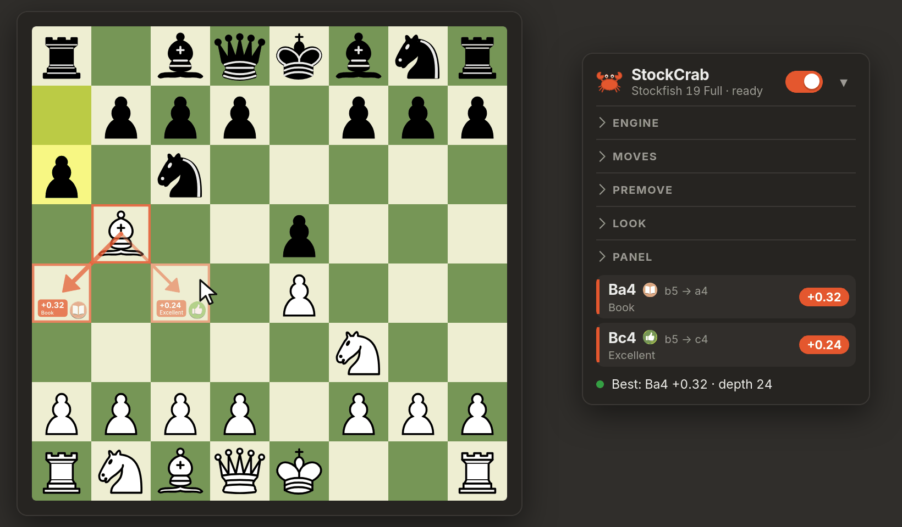
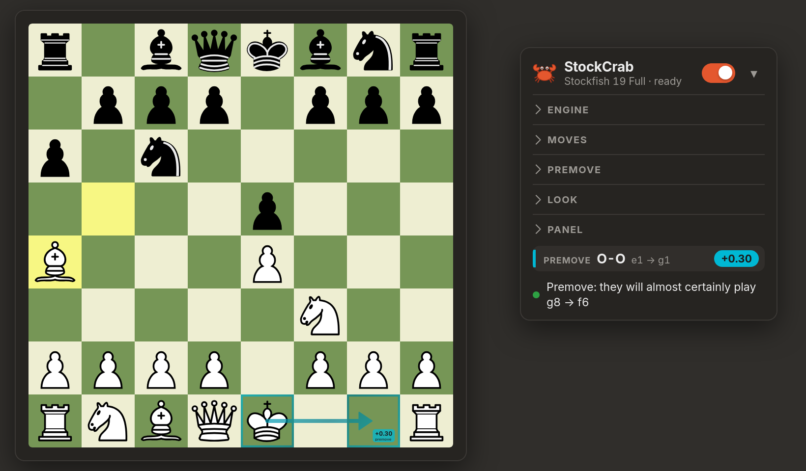

<div align="center">


<br>

#  StockCrab

**Stockfish move hints, drawn right on the board, on chess.com and lichess.**<br>
Best move, other good moves with a score for each, and a premove while your opponent thinks.

<br>

[](#install)
[](#chrome-edge-brave)
[](#engines)
[](LICENSE)
[](#privacy)

[**Install**](#install) &nbsp;·&nbsp; [Features](#features) &nbsp;·&nbsp; [Premoves](#premoves) &nbsp;·&nbsp; [Settings](#settings) &nbsp;·&nbsp; [Fair play](#fair-play) &nbsp;·&nbsp; [Intro video](docs/intro.mp4)

[Русская версия](README.ru.md)

</div>

<br>

<table>
<tr>
<td width="50%"></td>
<td width="50%"></td>
</tr>
<tr>
<td align="center"><sub>The best move and other good ones, each with its score</sub></td>
<td align="center"><sub>A premove is shown while the opponent thinks</sub></td>
</tr>
</table>

## Features

- **Hints on the board.** An arrow and outlined squares for the best move, a compact card on the target square with its score, plus up to three other good moves, drawn thinner. The colours slowly flow (orange and the crab's red, or orange and cyan, or off), a promotion says which piece (*= Queen*), and there is an optional blur under the arrows.
- **Premoves.** While your opponent thinks, StockCrab can show the reply worth premoving, in three styles, including a rule-based pawn retake ([how](#premoves)).
- **You choose the opponent.** Strength by Elo or Skill level, think time, depth and node limits, hash size, win / draw / loss, and an optional aggression slider (it gives up a little strength for sharper play). The panel shows only what the chosen model uses.
- **Openings and gambits.** Pick an opening for White and for Black from 3,865 book lines (every named opening and gambit, or just *Gambits*): the hints follow it while the game stays in the book and the move is not much worse, then the engine takes over.
- **Presets.** Ready sets of settings and your own: save, apply, copy and paste them as text.
- **Eight engines.** Stockfish 19 (Full, Lite, JavaScript), Stockfish 17.1 (Full, Lite), Stockfish 11 classic, Fairy-Stockfish and Maia 3, a network that plays like people of a given rating. If one does not start, another takes over ([engines](#engines)).
- **Honest numbers.** Only exact scores are used, lines come from the last *complete* depth, and a move never borrows the score of another move.
- **Works on both sites.** chess.com and lichess, including analysis boards and puzzles (set *I play: Whoever is to move*).
- **A panel that stays out of the way.** Flat and compact, light and dark theme, brand orange, `Alt+X` to switch on and off, four corners to dock to.
- **Private.** The engine runs inside your browser. No servers, no accounts, no tracking ([privacy](#privacy)).

## Install

StockCrab runs in **Firefox** and in **Chrome** (and Chromium browsers: Edge, Brave, Opera, Vivaldi). It is not in the add-on stores yet, so load it yourself.

### Firefox

1. Download the repository (**Code → Download ZIP**) and unpack it, or `git clone https://github.com/upidddd/stockcrab.git`.
2. In Firefox open `about:debugging#/runtime/this-firefox`.
3. Click **Load Temporary Add-on…** and choose `src/stockcrab/manifest.json`.
4. Open a game on chess.com or lichess. The panel appears in the bottom-right corner. Switch it on (or press `Alt+X`).

Temporary add-ons are removed when Firefox closes. For a permanent install use Firefox Developer Edition, Nightly or ESR with `xpinstall.signatures.required` set to `false` in `about:config`, pack it with `python3 packaging/build_xpi.py` (it writes `dist/stockcrab-<version>.xpi`) and open the file, or sign it as an unlisted add-on with [`web-ext sign`](https://extensionworkshop.com/documentation/develop/web-ext-command-reference/#web-ext-sign).

### Chrome, Edge, Brave

1. Get the Chrome build: download `stockcrab-chrome-<version>.zip` from [Releases](https://github.com/upidddd/stockcrab/releases) and unzip it, or build it from the source with `python3 packaging/build_chrome.py` (it writes `dist/chrome/`).
2. Open `chrome://extensions` (`edge://extensions`, `brave://extensions`), switch on **Developer mode**.
3. Click **Load unpacked** and choose the unzipped folder (or `dist/chrome`). Chrome 116 or newer.

It is the same code as the Firefox version. Chrome's background is a service worker, which cannot start the engine's Web Worker, so on Chrome the engine runs in an offscreen document ([how](docs/architecture.md#chrome)).

### First start

The first start of the full network takes a few seconds (the panel says *starting…*). If a model does not start in time, StockCrab falls back to Stockfish 19 Full, then Lite, and says so in the panel.

## Using it

| | |
|---|---|
| **Switch on / off** | the toggle in the panel, or `Alt+X` |
| **Which side is mine** | detected automatically; override it under *Panel → I play* (White, Black, or *Whoever is to move* for analysis boards) |
| **Look** | colours, line width, opacity, blur, which parts to draw, animations, score units (pawns, centipawns, win chance) |
| **Something looks wrong** | click the status line in the panel: it copies the position StockCrab read from the page, so you can paste it into a bug report |

## Premoves

While it is your opponent's turn, StockCrab can show (in cyan) a reply you could premove to save clock time. Three styles:

- **When it's worth it** *(default)*: only when they will almost certainly play one move, or every likely move leads to the same reply for you, and your reply is clearly better than your second choice.
- **Always, just in case**: your best reply to their most likely move, with how many of the other likely moves agree.
- **Only if it's safe**: only when your best reply is the same after *every* legal move they have.

On top of that, **pawn retakes** are premoved by rule: if they can take your pawn with a pawn and another pawn of yours can take back, the retake is shown, unless it is much worse than your best reply.

## Settings

| Section | What you can set |
|---|---|
| **Presets** | built-in sets (deep analysis, quick hints, club player, Maia 1500 / 2200, Fairy-Stockfish, gambit player, clean look), your own saved sets, copy and paste them as text |
| **Engine** | model; strength by Elo (500 … max, within what the model allows) or by Skill level (0 – 20), think time (0.5 – 30 s), depth and node limits, aggression, hash (16 – 256 MB), win / draw / loss; NNUE or classical evaluation for Fairy-Stockfish; for Maia: players' and opponent's rating, what the card shows. Only the settings the chosen model uses are shown |
| **Moves** | how many other good moves (0 – 3) and how far behind they may be (for Maia: how many players play them), score units, the move list in the panel |
| **Opening** | an opening for White and for Black (a name with its variations, *Any book line* or *Gambits*), how much worse than the engine's move a book move may be |
| **Premove** | on or off, style, how sure the style has to be, how many likely replies are checked and for how long |
| **Look** | colours, flowing colours, line width, opacity, blur under the hints, outline, arrow head, score, cell name, animations |
| **Panel** | corner, which side I play, the `Alt+X` hotkey |

## Engines

| Model | Notes |
|---|---|
| Stockfish 19 · Full | the strongest, about 95 MB, the default |
| Stockfish 19 · Lite | a small network, starts in a moment |
| Stockfish 19 · JavaScript | no WebAssembly, slowest, a last resort |
| Stockfish 17.1 · Full / Lite | the previous generation |
| Stockfish 11 · Classic | no Elo option in this build, so Elo is mapped onto Skill Level |
| Fairy-Stockfish | another engine of the Stockfish family, with Stockfish's NNUE network; Elo 500 – 2850 |
| Maia 3 · human-like | not a search: a neural network that suggests the moves people of the chosen rating (600 – 2600) play most, the most popular first; its scores are the network's own guess |

The Stockfish models are builds of [stockfish.js](https://github.com/nmrugg/stockfish.js) (GPLv3), which is based on [Stockfish](https://github.com/official-stockfish/Stockfish). [Fairy-Stockfish](https://github.com/fairy-stockfish/Fairy-Stockfish) (GPLv3) is built here single-threaded for the browser (`tools/fairy-stockfish/`). [Maia 3](https://github.com/CSSLab/maia-platform-frontend) is by the CSSLab, University of Toronto (GPLv3), and runs on [ONNX Runtime Web](https://github.com/microsoft/onnxruntime) (MIT) with [chess.js](https://github.com/jhlywa/chess.js) (BSD-2-Clause) for the rules.

## How it works

```
 chess.com / lichess page                      background (event page)
┌────────────────────────────┐   messages    ┌─────────────────────────────┐
│ content/  (20 scripts)     │ ────────────▶ │ background/  (10 scripts)   │
│  · reads the board         │               │  · queue of searches        │
│  · draws arrows, cards     │ ◀──────────── │  · Worker: Stockfish (WASM) │
│  · the panel (shadow DOM)  │   lines, score│  · UCI MultiPV, searchmoves │
└────────────────────────────┘               └─────────────────────────────┘
```

- **Reading the board.** On chess.com the game's own position is used when the page offers it, otherwise the pieces are read from the DOM; on lichess they are read from chessground. The side to move comes from the highlighted last move (and is remembered), a held piece freezes everything until it is dropped, impossible positions are skipped.
- **Searching.** One engine worker in the background page, `go movetime` / `go depth`, MultiPV for the other good moves, full strength for the premove searches.
- **Drawing.** One SVG over the board, laid out in the board's own pixels. The outlines and the arrow of a move are one layer, so overlaps never get darker. The card moves to the corner of the square that no arrow touches.

## Privacy

StockCrab makes **no network requests**. The engines are files in the extension and run in your browser. It asks only for the `storage` permission (your settings) and `clipboardWrite` (the *copy position* click), and it runs only on chess.com and lichess.org.

## Fair play

StockCrab shows engine moves in real time. That is great for **analysis, practice against bots, studying openings and learning**, and it is **not allowed in games against other people**: chess.com and lichess both forbid engine assistance there, and accounts that use it are closed. Please use it only where it is allowed. The author takes no responsibility for how it is used.

## Repository

```
src/stockcrab/       the extension: this folder is what Firefox loads
  content/           runs on the pages: board/ hints/ ui/ core/
  background/        hosts the engine: engine/ premove/
  engine/            the engine builds (Stockfish, Fairy-Stockfish, Maia 3) and their licences
  assets/            the extension's icon, the opening book (openings.json)
docs/                banner, screenshots, the intro video, architecture notes
packaging/           build_xpi.py (Firefox .xpi), build_chrome.py (Chrome folder and .zip)
platforms/chrome/    the Chrome glue: service worker, offscreen engine host, API shims
tools/               check.py checks the manifest and the scripts; fairy-stockfish/ builds Fairy-Stockfish; openings/ builds the opening book
.github/workflows/   builds both packages on every push and attaches them to a release
```

### Components

| Component | File | What it does |
|---|---|---|
| **Board reader** | `content/board/reader.js` | reads the position from chess.com, repairs the side to move, rejects impossible positions |
| **Lichess reader** | `content/board/lichess.js` | reads the position from lichess's board |
| **Orientation** | `content/board/orientation.js` | which colour is at the bottom and which one you play |
| **Hold tracker** | `content/core/hold.js` | waits while a piece is in your hand |
| **Main loop** | `content/core/tick.js` | every 250 ms: read, ask the engine, draw; retries after a failure |
| **Mark builder** | `content/hints/marks.js`, `score.js` | turns the engine's answer into the marks to draw, writes the scores |
| **Hint painter** | `content/hints/draw.js` | arrows, outlines and cards over the board |
| **Move finder** | `content/board/moves.js` | which move turned one position into the next (lichess side to move) |
| **Panel** | `content/ui/panel.js`, `content/ui/status.js` | the settings panel, its status line and move list |
| **Settings** | `content/core/settings.js` | defaults, saving, migration |
| **Engine registry** | `background/engine/models.js` | the eight engine models |
| **Search runner** and **Search queue** | `background/engine/search.js`, `queue.js` | one search at a time, a newer request replaces the waiting one |
| **UCI line builder** | `background/engine/uci-lines.js` | exact scores only, lines from the last complete depth |
| **Engine boot and recovery** | `background/engine/boot.js` | starts the engine, falls back to another build, restarts after a crash |
| **Aggression picker** | `background/engine/aggression.js` | a sharper move among nearly equal ones |
| **Premove analyst** | `background/premove/analysis.js` | the reply worth premoving (three styles) |
| **Pawn-trade rule** | `background/premove/pawn-trades.js` | the rule-based pawn retake |
| **Opening book** | `background/book.js` | the book moves of the chosen opening, checked against the engine |
| **Message router** | `background/main.js` | switches engines, answers the content scripts |

The complete list in load order, the data flow and how to add a file are in [`docs/architecture.md`](docs/architecture.md).

## Credits and licences

- StockCrab is released under the **GNU GPL v3** ([LICENSE](LICENSE)), the same licence as the bundled engines.
- Engines: [stockfish.js](https://github.com/nmrugg/stockfish.js) © Chess.com, LLC, and [Stockfish](https://github.com/official-stockfish/Stockfish) © the Stockfish developers (GPLv3).
- Opening book: [lichess-org/chess-openings](https://github.com/lichess-org/chess-openings) (CC0).
- Intro video: music *Free Uplifting Music* by [Seth_Makes_Sounds](https://freesound.org/people/Seth_Makes_Sounds/sounds/670819/) (CC0); chess pieces in the video: cburnett set; typeface: Inter.
- chess.com and lichess.org are trademarks of their owners. StockCrab is an independent project and is not affiliated with or endorsed by them.

<div align="center"><br><br><sub>Made with a crab.</sub></div>
