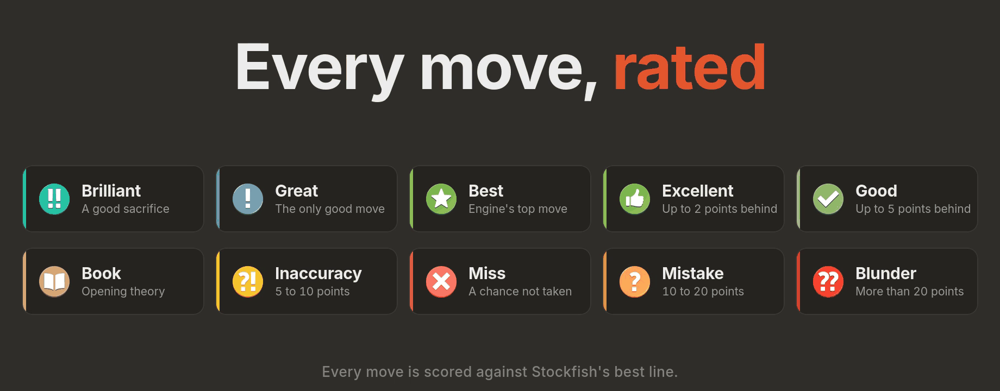

<div align="center">


<br>

#  StockCrab

**Stockfish move hints, drawn right on the board, on chess.com and lichess.**<br>
Best move, other good moves, a score for each, a rating for every move you play, and a premove while your opponent thinks.

<br>

[](#install)
[](#engines)
[](LICENSE)
[](#privacy)

[**Install**](#install) &nbsp;·&nbsp; [Features](#features) &nbsp;·&nbsp; [Move ratings](#move-ratings) &nbsp;·&nbsp; [Premoves](#premoves) &nbsp;·&nbsp; [Settings](#settings) &nbsp;·&nbsp; [Fair play](#fair-play) &nbsp;·&nbsp; [Intro video](assets/intro.mp4)

[Русская версия](README.ru.md)

</div>

<br>

<table>
<tr>
<td width="50%"></td>
<td width="50%"></td>
</tr>
<tr>
<td align="center"><sub>The best move and another good one, each with its score and rating</sub></td>
<td align="center"><sub>Your move is rated, then a premove is shown while the opponent thinks</sub></td>
</tr>
</table>

> The screenshots, the banner and the intro video show the extension with a custom set of move icons. Those icon files are **not** part of this repository: out of the box StockCrab draws its own icons. See [`icons/`](icons/README.md) to use your own.

## Features

- **Hints on the board.** An arrow and outlined squares for the best move, a compact card on the target square with its score and the kind of move, plus up to three other good moves, drawn thinner. Everything is translucent, with an optional blur under the arrows.
- **Every move rated.** Hints carry a rating, and after you play, your own move is rated too: Brilliant, Great, Best, Excellent, Good, Inaccuracy, Mistake, Blunder, Book, Forced and Miss ([how](#move-ratings)).
- **Premoves.** While your opponent thinks, StockCrab can show the reply worth premoving, in three styles, including a rule-based pawn retake ([how](#premoves)).
- **You choose the opponent.** Strength from Elo 1320 up to full strength, think time, depth limit, hash size, and an optional aggression slider (it gives up a little strength for sharper play).
- **Six engines.** Stockfish 19 (Full, Lite, JavaScript), Stockfish 17.1 (Full, Lite) and Stockfish 11 classic, with an automatic fallback if one does not start ([engines](#engines)).
- **Honest numbers.** Only exact scores are used, lines come from the last *complete* depth, and a move never borrows the score of another move.
- **Works on both sites.** chess.com and lichess, including analysis boards and puzzles (set *I play: Whoever is to move*).
- **A panel that stays out of the way.** Flat and compact, light and dark theme, brand orange, `Alt+X` to switch on and off, four corners to dock to.
- **Private.** The engine runs inside your browser. No servers, no accounts, no tracking ([privacy](#privacy)).

## Install

StockCrab is a Firefox extension (Manifest V3). It is not on addons.mozilla.org yet, so load it yourself:

1. Download the repository (**Code → Download ZIP**) and unpack it, or `git clone https://github.com/upidddd/stockcrab.git`.
2. In Firefox open `about:debugging#/runtime/this-firefox`.
3. Click **Load Temporary Add-on…** and choose the `manifest.json` from the folder.
4. Open a game on chess.com or lichess. The panel appears in the bottom-right corner. Switch it on (or press `Alt+X`).

Temporary add-ons are removed when Firefox closes. For a permanent install use Firefox Developer Edition, Nightly or ESR with `xpinstall.signatures.required` set to `false` in `about:config`, pack the folder as an `.xpi` (`zip -r ../stockcrab.xpi .`) and open it, or sign it as an unlisted add-on with [`web-ext sign`](https://extensionworkshop.com/documentation/develop/web-ext-command-reference/#web-ext-sign).

The first start of the full network takes a few seconds (the panel says *starting…*). If a model does not start in time, StockCrab falls back to Stockfish 19 Full, then Lite, and says so in the panel.

## Using it

| | |
|---|---|
| **Switch on / off** | the toggle in the panel, or `Alt+X` |
| **Which side is mine** | detected automatically; override it under *Panel → I play* (White, Black, or *Whoever is to move* for analysis boards) |
| **Look** | colours, line width, opacity, blur, which parts to draw, animations, score units (pawns, centipawns, win chance) |
| **Something looks wrong** | click the status line in the panel: it copies the position StockCrab read from the page, so you can paste it into a bug report |

## Move ratings

Ratings follow the bands of a chess.com style game review. Losses are measured in **win-chance points** against the engine's best line of the same depth (win chance = the lichess formula, `50 + 50 · (2 / (1 + e^(−0.00368208 · cp)) − 1)`).

| Rating | Meaning |
|---|---|
| **Brilliant** | a good piece sacrifice: the best (or nearly best) move leaves a piece en prise that the engine's line does not win back, you stay no worse than about −0.5, and no other move already wins by itself |
| **Great** | the only good move: every other move is clearly worse (10+ points), or 5+ points when it decides between winning, equal and losing |
| **Best** | the engine's first choice |
| **Excellent** | up to 2 points behind the best move |
| **Good** | up to 5 points behind |
| **Inaccuracy** | 5 to 10 points |
| **Mistake** | 10 to 20 points |
| **Blunder** | more than 20 points |
| **Book** | opening theory, from 7,981 positions of the [lichess opening collection](https://github.com/lichess-org/chess-openings) (CC0) |
| **Forced** | the only legal move |
| **Miss** | your opponent's last move gave you 10+ points, you were clearly better, and your move lost 5 to 20 of them |

Hints rate the move they suggest. After you play, your own move is rated against the hint's lines (or, if you moved before the hint was ready, against a quick analysis), and the rating appears on the square you moved to. Switch it off under *Moves → Rate the move I played*.

<p align="center"></p>

## Premoves

While it is your opponent's turn, StockCrab can show (in cyan) a reply you could premove to save clock time. Three styles:

- **When it's worth it** *(default)*: only when they will almost certainly play one move, or every likely move leads to the same reply for you, and your reply is clearly better than your second choice.
- **Always, just in case**: your best reply to their most likely move, with how many of the other likely moves agree.
- **Only if it's safe**: only when your best reply is the same after *every* legal move they have.

On top of that, **pawn retakes** are premoved by rule: if they can take your pawn with a pawn and another pawn of yours can take back, the retake is shown, unless it is much worse than your best reply.

## Settings

| Section | What you can set |
|---|---|
| **Engine** | strength (Elo 1320 … max), think time (0.5 – 30 s), depth limit, aggression, hash (16 – 256 MB), model |
| **Moves** | how many other good moves (0 – 3) and how far behind they may be, score units, rate the move I played, the move list in the panel |
| **Premove** | on or off, style, how sure the style has to be, how many likely replies are checked and for how long |
| **Look** | colours, line width, opacity, blur under the hints, outline, arrow head, score, icon, name of the kind of move, animations |
| **Panel** | corner, which side I play, the `Alt+X` hotkey |

## Engines

| Model | Notes |
|---|---|
| Stockfish 19 · Full | the strongest, about 95 MB, the default |
| Stockfish 19 · Lite | a small network, starts in a moment |
| Stockfish 19 · JavaScript | no WebAssembly, slowest, a last resort |
| Stockfish 17.1 · Full / Lite | the previous generation |
| Stockfish 11 · Classic | no Elo option in this build, so Elo is mapped onto Skill Level |

All of them are builds of [stockfish.js](https://github.com/nmrugg/stockfish.js) (GPLv3), which is based on [Stockfish](https://github.com/official-stockfish/Stockfish).

## How it works

```
 chess.com / lichess page                      background (event page)
┌────────────────────────────┐   messages    ┌─────────────────────────────┐
│ content.js                 │ ────────────▶ │ background.js               │
│  · reads the board         │               │  · queue of searches        │
│  · draws arrows, cards     │ ◀──────────── │  · Worker: Stockfish (WASM) │
│  · the panel (shadow DOM)  │   lines, score│  · UCI MultiPV, searchmoves │
└────────────────────────────┘               └─────────────────────────────┘
```

- **Reading the board.** On chess.com the game's own position is used when the page offers it, otherwise the pieces are read from the DOM; on lichess they are read from chessground. The side to move comes from the highlighted last move (and is remembered), a held piece freezes everything until it is dropped, impossible positions are skipped.
- **Searching.** One engine worker in the background page, `go movetime` / `go depth`, MultiPV for the other good moves, `searchmoves` to rate a move that is not among the lines, full strength for premove and rating searches.
- **Drawing.** One SVG over the board, laid out in the board's own pixels. The outlines and the arrow of a move are one layer, so overlaps never get darker. Cards and icons move to the corner of the square that no arrow touches.

## Privacy

StockCrab makes **no network requests**. The engines are files in the extension and run in your browser. It asks only for the `storage` permission (your settings) and `clipboardWrite` (the *copy position* click), and it runs only on chess.com and lichess.org.

## Fair play

StockCrab shows engine moves in real time. That is great for **analysis, practice against bots, studying openings and learning**, and it is **not allowed in games against other people**: chess.com and lichess both forbid engine assistance there, and accounts that use it are closed. Please use it only where it is allowed. The author takes no responsibility for how it is used.

## Repository

```
manifest.json      extension manifest (MV3)
content.js         board reading, drawing, panel, ratings
background.js      engine worker, searches, premove analysis
book.js            opening positions (hashes) for the Book rating
engine/            Stockfish builds and their licences
icons/             put your own move icons here (optional)
assets/            banner, screenshots, the intro video
```

## Credits and licences

- StockCrab is released under the **GNU GPL v3** ([LICENSE](LICENSE)), the same licence as the bundled engines.
- Engines: [stockfish.js](https://github.com/nmrugg/stockfish.js) © Chess.com, LLC, and [Stockfish](https://github.com/official-stockfish/Stockfish) © the Stockfish developers (GPLv3).
- Opening book: [lichess-org/chess-openings](https://github.com/lichess-org/chess-openings) (CC0).
- Intro video: music *Free Uplifting Music* by [Seth_Makes_Sounds](https://freesound.org/people/Seth_Makes_Sounds/sounds/670819/) (CC0); chess pieces in the video: cburnett set; typeface: Inter.
- chess.com and lichess.org are trademarks of their owners. StockCrab is an independent project and is not affiliated with or endorsed by them.

<div align="center"><br><br><sub>Made with a crab.</sub></div>
