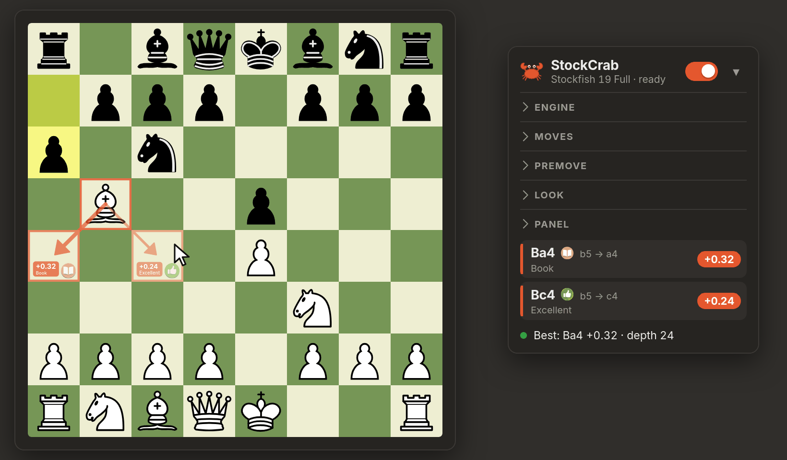
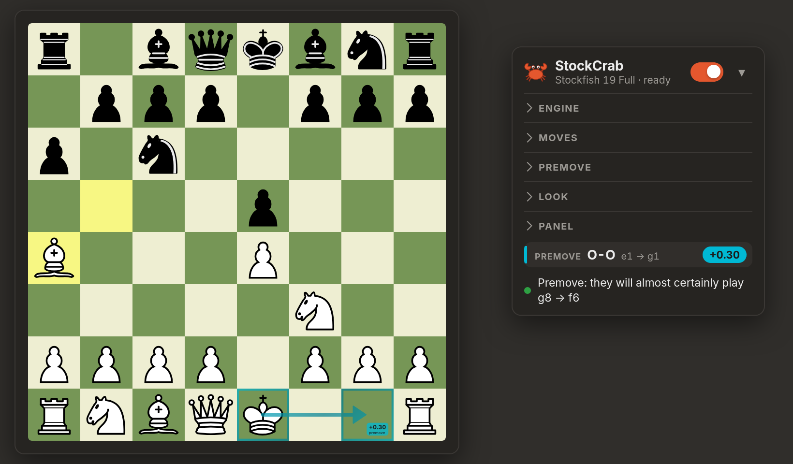

<div align="center">


<br>

#  StockCrab

**Подсказки Stockfish прямо на доске: на chess.com и на lichess.**<br>
Лучший ход, другие хорошие ходы со счётом для каждого и премув, пока соперник думает.

<br>

[](#установка)
[](#chrome-edge-brave)
[](#движки)
[](LICENSE)
[](#приватность)

[**Установка**](#установка) &nbsp;·&nbsp; [Возможности](#возможности) &nbsp;·&nbsp; [Сила](#сила) &nbsp;·&nbsp; [Премувы](#премувы) &nbsp;·&nbsp; [Честная игра](#честная-игра) &nbsp;·&nbsp; [Видео-интро](docs/intro.mp4)

[English version](README.md)

</div>

<br>

<table>
<tr>
<td width="50%"></td>
<td width="50%"></td>
</tr>
<tr>
<td align="center"><sub>Лучший ход и другие хорошие, у каждого свой счёт</sub></td>
<td align="center"><sub>Пока соперник думает, показан премув</sub></td>
</tr>
</table>

## Возможности

- **Подсказки на доске.** Стрелка (у коня буквой Г) и рамки клеток для лучшего хода, его счёт на клетке назначения и ещё до трёх хороших ходов тоньше. При превращении написано, в какую фигуру (*= Queen*); под стрелками можно включить размытие.
- **Сила от 200 до 3800 Elo.** Одна шкала для всех моделей Stockfish. В своём диапазоне движок ограничивает себя сам; ниже ход выбирается среди линий движка, и чем ниже Elo, тем чаще выпадает ход похуже; выше движок играет в полную силу с бюджетом перебора, который растёт вместе с Elo, а на 3800 бюджета нет вовсе ([подробнее](#сила)).
- **Анализ.** Шкала оценки рядом с доской, лучшая линия после каждого хода в списке и угроза соперника (ход, который он сыграл бы, будь сейчас его очередь) пунктирной стрелкой.
- **Премувы.** Пока соперник думает, StockCrab может показать ответ, который стоит сыграть премувом, в трёх стилях, включая взятие пешкой на пешку по правилу ([подробнее](#премувы)).
- **Дебюты и гамбиты.** Выберите дебют за белых и за чёрных из 3 865 книжных линий (все известные дебюты и гамбиты или просто *Gambits*): подсказки идут по нему, пока партия в книге и ход не намного хуже, дальше работает движок.
- **Все настройки движка.** Кроме основных ползунков, раздел *Engine options* показывает всё, что умеет выбранный движок (Move Overhead, nodestime, Contempt, поиск мата у Maia…), со своими значениями для каждой модели.
- **Конфиги.** Сохраните все настройки под именем, переключайтесь между ними, выгружайте в файл `.json` и загружайте обратно.
- **StockCrab Lite для телефонов.** Лёгкая сборка примерно на 3 МБ с маленькими движками и панелью вдоль нижнего края экрана под пальцы ([установка](#телефоны-stockcrab-lite)).
- **Семь движков.** Stockfish 19 (Full, Lite, Quick, JavaScript), классический Stockfish 11, Fairy-Stockfish и Maia 3, нейросеть, которая играет как люди заданного рейтинга. Если выбранный не запустился, включается запасной ([движки](#движки)).
- **Оба сайта.** chess.com и lichess, включая доски анализа и задачи (в настройке *I play* выберите *Whoever is to move*).
- **Панель.** Светлая или тёмная, свой цвет акцента, `Alt+X` включает и выключает, любой из четырёх углов; по желанию HUD с включёнными функциями и след курсора.
- **Обновления.** Панель сообщает о новой версии, а сборки для Firefox обновляются сами из релиза на GitHub.
- **Приватность.** Движок работает внутри браузера. Никаких серверов, аккаунтов и слежки; единственный запрос в сеть это необязательная проверка обновлений ([приватность](#приватность)).

## Установка

StockCrab работает в **Firefox** и в **Chrome** (и в браузерах на Chromium: Edge, Brave, Opera, Vivaldi). В магазинах расширений его пока нет, поэтому ставится вручную.

### Firefox

Скачайте `stockcrab-<версия>.xpi` из [Releases](https://github.com/upidddd/stockcrab/releases) и откройте его в Firefox (или перетащите в окно Firefox). Файлы релизов подписаны Mozilla как неопубликованное расширение, поэтому ставятся в любой Firefox, а дальше расширение обновляется само.

Из исходников:

1. Скачайте репозиторий (**Code → Download ZIP**) и распакуйте, либо `git clone https://github.com/upidddd/stockcrab.git`.
2. В Firefox откройте `about:debugging#/runtime/this-firefox`.
3. Нажмите **Load Temporary Add-on…** и выберите `src/stockcrab/manifest.json`.
4. Откройте партию на chess.com или lichess. Панель появится в правом нижнем углу. Включите её (или нажмите `Alt+X`).

Временные расширения пропадают при закрытии Firefox. Для постоянной установки используйте Firefox Developer Edition, Nightly или ESR, поставьте `xpinstall.signatures.required` в `false` в `about:config`, упакуйте расширение командой `python3 packaging/build_xpi.py` (создаст `dist/stockcrab-<версия>.xpi`) и откройте файл. Либо подпишите расширение как неопубликованное через [`web-ext sign`](https://extensionworkshop.com/documentation/develop/web-ext-command-reference/#web-ext-sign).

### Chrome, Edge, Brave

1. Возьмите сборку для Chrome: скачайте `stockcrab-chrome-<версия>.zip` из [Releases](https://github.com/upidddd/stockcrab/releases) и распакуйте, либо соберите из исходников: `python3 packaging/build_chrome.py` (создаст `dist/chrome/`).
2. Откройте `chrome://extensions` (`edge://extensions`, `brave://extensions`) и включите **Режим разработчика**.
3. Нажмите **Загрузить распакованное** и выберите распакованную папку (или `dist/chrome`). Нужен Chrome 116 или новее.

Это тот же код, что и в версии для Firefox. Фон в Chrome это service worker, а он не может запустить Web Worker с движком, поэтому в Chrome движок работает в offscreen-документе ([подробнее](docs/architecture.md#chrome)).

### Телефоны (StockCrab Lite)

Лёгкая сборка лежит в [Releases](https://github.com/upidddd/stockcrab/releases): `stockcrab-lite-<версия>.xpi` для Firefox и `stockcrab-lite-chrome-<версия>.zip` для браузеров на Chromium, которые умеют ставить расширения. В ней только Stockfish 19 Lite, Quick и JavaScript, панель стартует свёрнутой в полоску под доской (▸ открывает настройки), и она ставится рядом с полной версией. Собрать самому: `python3 packaging/build_mobile.py --chrome`.

- **Firefox для Android** (Nightly или Beta): *Настройки → О Firefox*, пять раз нажмите на логотип, чтобы открыть меню отладки, затем *Настройки → Установить расширение из файла* и выберите `.xpi` (он подписан Mozilla, как и версия для компьютера). Обновляется сама из релизов, как и версия для компьютера.
- **Браузеры на Chromium с расширениями** (Lemur, Quetta и подобные): распакуйте `.zip`, откройте страницу расширений браузера, включите режим разработчика и загрузите папку.

### Первый запуск

Первый запуск полной сети занимает несколько секунд (в панели написано *starting…*). Если модель не успела запуститься, StockCrab переключится на Stockfish 19 Full, потом на Lite и напишет об этом в панели.

## Как пользоваться

| | |
|---|---|
| **Включить / выключить** | переключатель в панели или `Alt+X` |
| **За кого вы играете** | определяется сам; можно задать вручную в *Panel → I play* (White, Black или *Whoever is to move* для досок анализа) |
| **Вид** | цвета, толщина линий, прозрачность, размытие, какие части рисовать, анимации, единицы счёта (пешки, сотые пешки, шанс победы) |
| **Что-то выглядит неверно** | нажмите на строку статуса в панели: она копирует позицию, которую StockCrab прочитал со страницы, её удобно вставить в баг-репорт |

## Премувы

Пока ход соперника, StockCrab может показать (голубым) ответ, который можно сыграть премувом, чтобы сэкономить время на часах. Три стиля:

- **When it's worth it** *(по умолчанию)*: только когда соперник почти наверняка сыграет один ход, либо все вероятные ходы ведут к одному вашему ответу, и этот ответ заметно лучше вашего второго выбора.
- **Always, just in case**: ваш лучший ответ на самый вероятный ход соперника и сколько из остальных вероятных ходов с ним согласны.
- **Only if it's safe**: только когда ваш лучший ответ одинаков после *любого* легального хода соперника.

Кроме того, **взятие пешкой на пешку** показывается по правилу: если соперник может взять вашу пешку пешкой, а другая ваша пешка может взять обратно, показывается это взятие, если оно не намного хуже вашего лучшего ответа.

## Настройки

| Раздел | Что настраивается |
|---|---|
| **Configs** | свои наборы всех настроек: сохранить под именем, выбрать из списка, чтобы применить, удалить, выгрузить в файл, загрузить из файла |
| **Engine** | модель; сила по Elo (200 – 3800 на любой модели Stockfish, [подробнее](#сила)) или по Skill level (0 – 20), время на ход (0.5 – 30 с), ограничения глубины и узлов, агрессия, хеш (16 – 256 МБ), выигрыш / ничья / проигрыш; NNUE или классическая оценка у Fairy-Stockfish; для Maia: рейтинг игроков и соперника, что писать на карточке. Показываются только настройки выбранной модели |
| **Engine options** | все опции, которые сообщает выбранный движок (например Move Overhead, nodestime, Ponder, UCI_Chess960; Contempt у Stockfish 11; глубина и время поиска мата у Maia), со сбросом |
| **Moves** | сколько других хороших ходов (0 – 3) и насколько они могут отставать (для Maia: сколько игроков их играют), единицы счёта, счёт для того, чей ход, или для белых, список ходов в панели |
| **Analysis** | шкала оценки, сколько ходов лучшей линии показывать в списке (0 – 10), угроза соперника и её цвет |
| **Opening** | дебют за белых и за чёрных (название со всеми вариантами, *Any book line* или *Gambits*), насколько книжный ход может быть хуже хода движка |
| **Premove** | вкл/выкл, стиль, насколько уверенным должен быть стиль, сколько вероятных ответов проверяется и как долго |
| **Look** | тема панели, цвет акцента, цвета подсказок, толщина линий, прозрачность, размытие под подсказками, рамки, наконечник стрелки, счёт на доске, анимации, след курсора |
| **Panel** | угол, за кого я играю, горячая клавиша `Alt+X`, HUD и его угол, проверка обновлений |

## Сила

Ползунок *Strength (Elo)* идёт от 200 до 3800 на любой модели Stockfish, и каждый его шаг меняет игру движка:

| Elo | Что делает движок |
|---|---|
| ниже собственного диапазона модели (меньше 1320 у Stockfish, 500 у Fairy-Stockfish) | играет на своём минимальном Elo с восемью линиями и выбирает одну из них: вес линии зависит от того, сколько ожидаемого очка она теряет, и чем ниже Elo, тем чаще выигрывает линия похуже. Одна и та же позиция на одном и том же Elo всегда даёт один и тот же ход |
| внутри диапазона модели | собственное ограничение движка `UCI_Elo` |
| от верха диапазона до 3799 | полная сила в пределах бюджета узлов: 40 тысяч узлов у верха диапазона, до 4 миллионов перед 3800 (берётся меньшее из этого и *Max nodes*) |
| 3800 | полная сила без бюджета |

У Stockfish 11 нет `UCI_Elo`, поэтому внутри диапазона Elo переводится в *Skill Level*. У Maia свой рейтинг (600 – 2600). Премувы и угроза всегда считаются в полную силу.

## Движки

| Модель | Примечания |
|---|---|
| Stockfish 19 · Full | самая сильная, около 95 МБ, по умолчанию |
| Stockfish 19 · Lite | небольшая сеть, запускается сразу |
| Stockfish 19 · Quick | сеть Lite с перебором на маленькую фиксированную глубину (1 – 20, по умолчанию 8): отвечает сразу, играет слабее |
| Stockfish 19 · JavaScript | без WebAssembly, самая медленная, на крайний случай |
| Stockfish 11 · Classic | в этой сборке нет настройки Elo, поэтому Elo переводится в Skill Level |
| Fairy-Stockfish | другой движок семейства Stockfish, с NNUE-сетью Stockfish; Elo 500 – 2850 |
| Maia 3 · human-like | не перебор, а нейросеть: предлагает ходы, которые чаще всего играют люди выбранного рейтинга (600 – 2600), самый популярный первым; оценки дает сама сеть |

Модели Stockfish собраны из [stockfish.js](https://github.com/nmrugg/stockfish.js) (GPLv3), который основан на [Stockfish](https://github.com/official-stockfish/Stockfish). [Fairy-Stockfish](https://github.com/fairy-stockfish/Fairy-Stockfish) (GPLv3) собран здесь однопоточным для браузера (`tools/fairy-stockfish/`). [Maia 3](https://github.com/CSSLab/maia-platform-frontend) сделана CSSLab, Университет Торонто (GPLv3), и работает на [ONNX Runtime Web](https://github.com/microsoft/onnxruntime) (MIT), правила шахмат берёт из [chess.js](https://github.com/jhlywa/chess.js) (BSD-2-Clause).

## Как это устроено

```
 страница chess.com / lichess                 фоновая страница
┌────────────────────────────┐  сообщения    ┌─────────────────────────────┐
│ content/  (19 скриптов)    │ ────────────▶ │ background/  (14 скриптов)  │
│  · читает доску            │               │  · очередь поисков          │
│  · рисует стрелки, карточки│ ◀──────────── │  · Worker: Stockfish (WASM) │
│  · панель (shadow DOM)     │  линии, счёт  │  · UCI MultiPV, searchmoves │
└────────────────────────────┘               └─────────────────────────────┘
```

- **Чтение доски.** На chess.com используется собственная позиция игры, если страница её отдаёт, иначе фигуры читаются из DOM; на lichess они читаются из chessground. Чей ход, определяется по подсвеченному последнему ходу (и запоминается), пока вы держите фигуру, всё замораживается, невозможные позиции пропускаются.
- **Поиск.** Один движок в фоновой странице, `go movetime` / `go depth`, MultiPV для других хороших ходов, поиски для премувов на полной силе.
- **Рисование.** Один SVG поверх доски в её собственных пикселях. Рамки и стрелка одного хода это один слой, поэтому в местах наложения ничего не темнеет. Карточка уходит в тот угол клетки, которого стрелка не касается.

## Приватность

Движки это файлы внутри расширения, они работают в вашем браузере. Единственный запрос в сеть это проверка обновлений: панель спрашивает у GitHub (`api.github.com`) последний релиз не чаще раза в 6 часов, выключается в *Panel → Check for updates*; сборка для Firefox также пользуется встроенной проверкой обновлений Firefox по релизу. Нужны только разрешение `storage` (ваши настройки) и `clipboardWrite` (копирование позиции кликом), а работает оно только на chess.com и lichess.org.

## Честная игра

StockCrab показывает ходы движка в реальном времени. Это отлично для **анализа, тренировки против ботов, изучения дебютов и обучения** и **недопустимо в партиях против людей**: chess.com и lichess запрещают там помощь движка, а аккаунты, которые ею пользуются, закрывают. Пользуйтесь расширением только там, где это разрешено. Автор не отвечает за то, как оно используется.

## Репозиторий

```
src/stockcrab/       расширение: именно эту папку загружает Firefox
  content/           работает на страницах: board/ hints/ ui/ core/
  background/        держит движок: engine/ premove/
  engine/            сборки движков (Stockfish, Fairy-Stockfish, Maia 3) и их лицензии
  assets/            иконка расширения, дебютная книга (openings.json)
docs/                баннер, скриншоты, видео-интро, описание устройства
packaging/           build_xpi.py (Firefox .xpi), build_chrome.py (папка и .zip для Chrome), build_mobile.py (StockCrab Lite)
platforms/chrome/    обвязка для Chrome: service worker, offscreen-документ с движком, замены API
tools/               check.py проверяет манифест и скрипты; fairy-stockfish/ собирает Fairy-Stockfish; openings/ собирает дебютную книгу
.github/workflows/   собирает обе версии при каждом пуше и прикладывает их к релизу
```

### Компоненты

| Компонент | Файл | Что делает |
|---|---|---|
| **Board reader** (читатель доски) | `content/board/reader.js` | читает позицию с chess.com, чинит чей ход, отбрасывает невозможные позиции |
| **Lichess reader** | `content/board/lichess.js` | читает позицию с доски lichess |
| **Orientation** (ориентация) | `content/board/orientation.js` | какой цвет внизу и за какой цвет играете вы |
| **Hold tracker** | `content/core/hold.js` | ждёт, пока фигура в вашей руке |
| **Main loop** (главный цикл) | `content/core/tick.js` | каждые 250 мс: читает, спрашивает движок, рисует; повторяет после сбоя |
| **Mark builder** | `content/hints/marks.js` | превращает ответ движка в метки для рисования |
| **Hint painter** (рисовальщик) | `content/hints/draw.js` | стрелки, рамки и карточки поверх доски |
| **Move finder** | `content/board/moves.js` | какой ход превратил одну позицию в другую (чей ход на lichess) |
| **Evaluation bar** (шкала оценки) | `content/hints/evalbar.js` | шансы белых рядом с доской |
| **Panel** (панель) | `content/ui/panel.js`, `content/ui/status.js` | панель настроек, её строка статуса и список ходов, HUD |
| **Cursor trail** (след курсора) | `content/ui/trail.js` | лента за указателем мыши |
| **Settings** | `content/core/settings.js` | значения по умолчанию, сохранение, миграция |
| **Build flag** | `build.js` | полная сборка или StockCrab Lite (общий для страницы и фона) |
| **Engine registry** | `background/engine/models.js` | семь моделей движков |
| **Strength** (сила) | `background/engine/strength.js` | шкала Elo 200 – 3800 |
| **Search runner** и **Search queue** | `background/engine/search.js`, `queue.js` | один поиск за раз, новый запрос заменяет ожидающий |
| **UCI line builder** | `background/engine/uci-lines.js` | только точные оценки, линии по последней полной глубине |
| **Engine boot and recovery** | `background/engine/boot.js` | запускает движок, переключается на другую сборку, перезапускает после падения |
| **Aggression picker** | `background/engine/aggression.js` | более острый ход среди почти равных |
| **Premove analyst** | `background/premove/analysis.js` | ответ, который стоит сыграть премувом (три стиля) |
| **Pawn-trade rule** | `background/premove/pawn-trades.js` | взятие пешкой на пешку по правилу |
| **Opening book** | `background/book.js` | книжные ходы выбранного дебюта, проверенные движком |
| **Message router** | `background/main.js` | переключает движки, отвечает скриптам страницы |

Полный список в порядке загрузки, поток данных и как добавить файл описаны в [`docs/architecture.md`](docs/architecture.md).

## Авторство и лицензии

- StockCrab выпускается под **GNU GPL v3** ([LICENSE](LICENSE)), как и встроенные движки.
- Движки: [stockfish.js](https://github.com/nmrugg/stockfish.js) © Chess.com, LLC и [Stockfish](https://github.com/official-stockfish/Stockfish) © разработчики Stockfish (GPLv3).
- Дебютная книга: [lichess-org/chess-openings](https://github.com/lichess-org/chess-openings) (CC0).
- Видео-интро: музыка *Free Uplifting Music* автора [Seth_Makes_Sounds](https://freesound.org/people/Seth_Makes_Sounds/sounds/670819/) (CC0); шахматные фигуры в видео: набор cburnett; шрифт: Inter.
- chess.com и lichess.org являются товарными знаками их владельцев. StockCrab независимый проект и не связан с ними и не одобрен ими.

<div align="center"><br><br><sub>Сделано с крабом.</sub></div>
