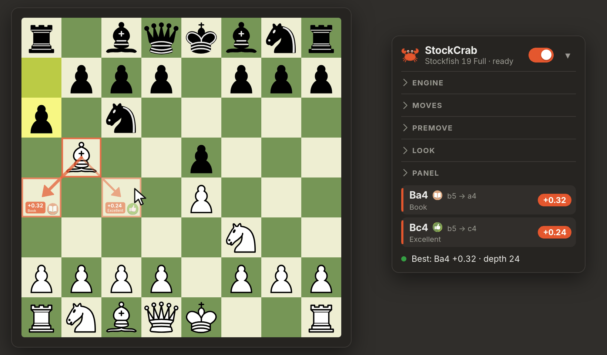
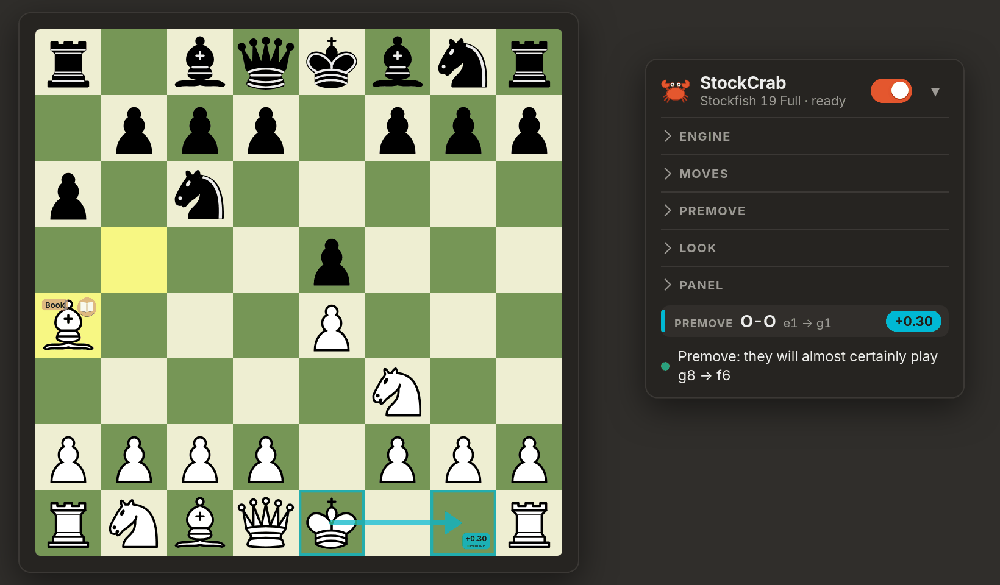
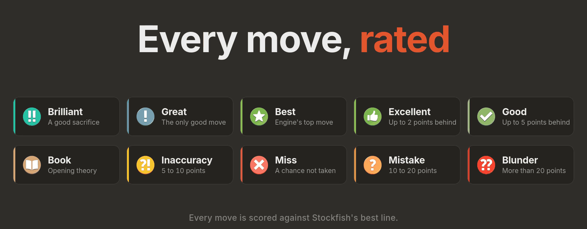

<div align="center">


<br>

#  StockCrab

**Подсказки Stockfish прямо на доске: на chess.com и на lichess.**<br>
Лучший ход, другие хорошие ходы, оценка каждого, рейтинг каждого вашего хода и премув, пока соперник думает.

<br>

[](#установка)
[](#движки)
[](LICENSE)
[](#приватность)

[**Установка**](#установка) &nbsp;·&nbsp; [Возможности](#возможности) &nbsp;·&nbsp; [Оценки ходов](#оценки-ходов) &nbsp;·&nbsp; [Премувы](#премувы) &nbsp;·&nbsp; [Честная игра](#честная-игра) &nbsp;·&nbsp; [Видео-интро](docs/intro.mp4)

[English version](README.md)

</div>

<br>

<table>
<tr>
<td width="50%"></td>
<td width="50%"></td>
</tr>
<tr>
<td align="center"><sub>Лучший ход и ещё один хороший: у каждого счёт и оценка</sub></td>
<td align="center"><sub>Ваш ход оценён, а пока соперник думает, показан премув</sub></td>
</tr>
</table>

> На скриншотах, в баннере и в видео расширение показано со своим набором иконок ходов. Эти файлы **не входят** в репозиторий: из коробки StockCrab рисует собственные иконки. Как подключить свои, написано в [`src/stockcrab/icons/`](src/stockcrab/icons/README.md).

## Возможности

- **Подсказки на доске.** Стрелка и рамки клеток для лучшего хода, компактная карточка на клетке назначения со счётом и видом хода, ещё до трёх хороших ходов тоньше. Всё полупрозрачное, под стрелками можно включить размытие.
- **Оценка каждого хода.** У подсказок есть оценка, а после вашего хода оценивается и он сам: Brilliant, Great, Best, Excellent, Good, Inaccuracy, Mistake, Blunder, Book, Forced и Miss ([как это считается](#оценки-ходов)).
- **Премувы.** Пока соперник думает, StockCrab может показать ответ, который стоит сыграть премувом, в трёх стилях, включая взятие пешкой на пешку по правилу ([подробнее](#премувы)).
- **Вы выбираете соперника.** Сила от Elo 1320 до полной, время на ход, глубина, размер хеша и необязательная агрессия (немного силы в обмен на более острую игру).
- **Шесть движков.** Stockfish 19 (Full, Lite, JavaScript), Stockfish 17.1 (Full, Lite) и классический Stockfish 11. Если выбранный не запустился, включается запасной ([движки](#движки)).
- **Честные числа.** Берутся только точные оценки, линии строятся по последней *полностью* пройденной глубине, а ходу никогда не достаётся оценка другого хода.
- **Оба сайта.** chess.com и lichess, включая доски анализа и задачи (в настройке *I play* выберите *Whoever is to move*).
- **Панель не мешает.** Плоская и компактная, светлая и тёмная тема, фирменный оранжевый, `Alt+X` включает и выключает, можно прижать к любому из четырёх углов.
- **Приватность.** Движок работает внутри браузера. Никаких серверов, аккаунтов и слежки ([приватность](#приватность)).

## Установка

StockCrab это расширение для Firefox (Manifest V3). В каталоге addons.mozilla.org его пока нет, поэтому ставится вручную:

1. Скачайте репозиторий (**Code → Download ZIP**) и распакуйте, либо `git clone https://github.com/upidddd/stockcrab.git`.
2. В Firefox откройте `about:debugging#/runtime/this-firefox`.
3. Нажмите **Load Temporary Add-on…** и выберите `src/stockcrab/manifest.json`.
4. Откройте партию на chess.com или lichess. Панель появится в правом нижнем углу. Включите её (или нажмите `Alt+X`).

Временные расширения пропадают при закрытии Firefox. Для постоянной установки используйте Firefox Developer Edition, Nightly или ESR, поставьте `xpinstall.signatures.required` в `false` в `about:config`, упакуйте расширение командой `python3 packaging/build_xpi.py` (создаст `dist/stockcrab-<версия>.xpi`) и откройте файл. Либо подпишите расширение как неопубликованное через [`web-ext sign`](https://extensionworkshop.com/documentation/develop/web-ext-command-reference/#web-ext-sign).

Первый запуск полной сети занимает несколько секунд (в панели написано *starting…*). Если модель не успела запуститься, StockCrab переключится на Stockfish 19 Full, потом на Lite и напишет об этом в панели.

## Как пользоваться

| | |
|---|---|
| **Включить / выключить** | переключатель в панели или `Alt+X` |
| **За кого вы играете** | определяется сам; можно задать вручную в *Panel → I play* (White, Black или *Whoever is to move* для досок анализа) |
| **Вид** | цвета, толщина линий, прозрачность, размытие, какие части рисовать, анимации, единицы счёта (пешки, сотые пешки, шанс победы) |
| **Что-то выглядит неверно** | нажмите на строку статуса в панели: она копирует позицию, которую StockCrab прочитал со страницы, её удобно вставить в баг-репорт |

## Оценки ходов

Оценки устроены по полосам игрового обзора как на chess.com. Потери считаются в **очках шанса на победу** относительно лучшей линии движка той же глубины (шанс на победу по формуле lichess: `50 + 50 · (2 / (1 + e^(−0.00368208 · cp)) − 1)`).

| Оценка | Что значит |
|---|---|
| **Brilliant** | хорошая жертва фигуры: лучший (или почти лучший) ход оставляет фигуру под боем, и линия движка её не возвращает; вы остаётесь не хуже примерно −0.5, и ни один другой ход уже не выигрывает сам |
| **Great** | единственный хороший ход: все остальные заметно хуже (от 10 очков), либо от 5 очков, если ход решает между выигрышем, равенством и проигрышем |
| **Best** | первый выбор движка |
| **Excellent** | отстаёт от лучшего не больше чем на 2 очка |
| **Good** | до 5 очков |
| **Inaccuracy** | от 5 до 10 очков |
| **Mistake** | от 10 до 20 очков |
| **Blunder** | больше 20 очков |
| **Book** | дебютная теория: 7 981 позиция из [коллекции дебютов lichess](https://github.com/lichess-org/chess-openings) (CC0) |
| **Forced** | единственный легальный ход |
| **Miss** | прошлый ход соперника дал вам от 10 очков, вы стояли явно лучше, а ваш ход потерял от 5 до 20 из них |

Подсказки оценивают тот ход, который предлагают. После вашего хода он оценивается по линиям подсказки (а если вы пошли раньше, чем она была готова, по быстрому анализу), и оценка появляется на клетке, куда вы пошли. Выключается в *Moves → Rate the move I played*.

<p align="center"></p>

## Премувы

Пока ход соперника, StockCrab может показать (голубым) ответ, который можно сыграть премувом, чтобы сэкономить время на часах. Три стиля:

- **When it's worth it** *(по умолчанию)*: только когда соперник почти наверняка сыграет один ход, либо все вероятные ходы ведут к одному вашему ответу, и этот ответ заметно лучше вашего второго выбора.
- **Always, just in case**: ваш лучший ответ на самый вероятный ход соперника и сколько из остальных вероятных ходов с ним согласны.
- **Only if it's safe**: только когда ваш лучший ответ одинаков после *любого* легального хода соперника.

Кроме того, **взятие пешкой на пешку** показывается по правилу: если соперник может взять вашу пешку пешкой, а другая ваша пешка может взять обратно, показывается это взятие, если оно не намного хуже вашего лучшего ответа.

## Настройки

| Раздел | Что настраивается |
|---|---|
| **Engine** | сила (Elo 1320 … max), время на ход (0.5 – 30 с), ограничение глубины, агрессия, хеш (16 – 256 МБ), модель |
| **Moves** | сколько других хороших ходов (0 – 3) и насколько они могут отставать, единицы счёта, оценка сыгранного хода, список ходов в панели |
| **Premove** | вкл/выкл, стиль, насколько уверенным должен быть стиль, сколько вероятных ответов проверяется и как долго |
| **Look** | цвета, толщина линий, прозрачность, размытие под подсказками, рамки, наконечник стрелки, счёт, значок, название вида хода, анимации |
| **Panel** | угол, за кого я играю, горячая клавиша `Alt+X` |

## Движки

| Модель | Примечания |
|---|---|
| Stockfish 19 · Full | самая сильная, около 95 МБ, по умолчанию |
| Stockfish 19 · Lite | небольшая сеть, запускается сразу |
| Stockfish 19 · JavaScript | без WebAssembly, самая медленная, на крайний случай |
| Stockfish 17.1 · Full / Lite | предыдущее поколение |
| Stockfish 11 · Classic | в этой сборке нет настройки Elo, поэтому Elo переводится в Skill Level |

Все они собраны из [stockfish.js](https://github.com/nmrugg/stockfish.js) (GPLv3), который основан на [Stockfish](https://github.com/official-stockfish/Stockfish).

## Как это устроено

```
 страница chess.com / lichess                 фоновая страница
┌────────────────────────────┐  сообщения    ┌─────────────────────────────┐
│ content/  (20 скриптов)    │ ────────────▶ │ background/  (10 скриптов)  │
│  · читает доску            │               │  · очередь поисков          │
│  · рисует стрелки, карточки│ ◀──────────── │  · Worker: Stockfish (WASM) │
│  · панель (shadow DOM)     │  линии, счёт  │  · UCI MultiPV, searchmoves │
└────────────────────────────┘               └─────────────────────────────┘
```

- **Чтение доски.** На chess.com используется собственная позиция игры, если страница её отдаёт, иначе фигуры читаются из DOM; на lichess они читаются из chessground. Чей ход, определяется по подсвеченному последнему ходу (и запоминается), пока вы держите фигуру, всё замораживается, невозможные позиции пропускаются.
- **Поиск.** Один движок в фоновой странице, `go movetime` / `go depth`, MultiPV для других хороших ходов, `searchmoves`, чтобы оценить ход, которого нет среди линий; поиски для премува и оценок идут на полной силе.
- **Рисование.** Один SVG поверх доски в её собственных пикселях. Рамки и стрелка одного хода это один слой, поэтому в местах наложения ничего не темнеет. Карточки и значки уходят в тот угол клетки, которого стрелка не касается.

## Приватность

StockCrab **не делает запросов в сеть**. Движки это файлы внутри расширения, они работают в вашем браузере. Нужны только разрешение `storage` (ваши настройки) и `clipboardWrite` (копирование позиции кликом), а работает оно только на chess.com и lichess.org.

## Честная игра

StockCrab показывает ходы движка в реальном времени. Это отлично для **анализа, тренировки против ботов, изучения дебютов и обучения** и **недопустимо в партиях против людей**: chess.com и lichess запрещают там помощь движка, а аккаунты, которые ею пользуются, закрывают. Пользуйтесь расширением только там, где это разрешено. Автор не отвечает за то, как оно используется.

## Репозиторий

```
src/stockcrab/       расширение: именно эту папку загружает Firefox
  content/           работает на страницах: board/ hints/ rating/ ui/ core/
  background/        держит движок: engine/ premove/
  data/              дебютная книга
  engine/            сборки Stockfish и их лицензии
  icons/             ваши иконки ходов (необязательно)
  assets/            иконка расширения
docs/                баннер, скриншоты, видео-интро, описание устройства
packaging/           build_xpi.py упаковывает расширение в .xpi
tools/               check.py проверяет манифест и скрипты
.github/workflows/   собирает .xpi при каждом пуше и прикладывает к релизу
```

### Компоненты

| Компонент | Файл | Что делает |
|---|---|---|
| **Board reader** (читатель доски) | `content/board/reader.js` | читает позицию с chess.com, чинит чей ход, отбрасывает невозможные позиции |
| **Lichess reader** | `content/board/lichess.js` | читает позицию с доски lichess |
| **Orientation** (ориентация) | `content/board/orientation.js` | какой цвет внизу и за какой цвет играете вы |
| **Hold tracker** | `content/core/hold.js` | ждёт, пока фигура в вашей руке |
| **Main loop** (главный цикл) | `content/core/tick.js` | каждые 250 мс: читает, спрашивает движок, рисует; повторяет после сбоя |
| **Mark builder** | `content/hints/marks.js` | превращает ответ движка в метки для рисования |
| **Hint painter** (рисовальщик) | `content/hints/draw.js` | стрелки, рамки, карточки и значки поверх доски |
| **Icon kit** | `content/hints/icons.js` | встроенные векторные значки и ваши файлы иконок |
| **Move classifier** | `content/rating/classify.js` | Great, Miss и сам классификатор |
| **Sacrifice detector** | `content/rating/sacrifice.js` | отличает настоящую жертву фигуры (Brilliant) |
| **Opening book** | `content/rating/book.js`, `data/opening-book.js` | отличает дебютную теорию (Book) |
| **Played-move rater** | `content/rating/played-move.js` | оценивает ход, который вы только что сыграли |
| **Panel** (панель) | `content/ui/panel.js`, `content/ui/status.js` | панель настроек, её строка статуса и список ходов |
| **Settings** | `content/core/settings.js` | значения по умолчанию, сохранение, миграция |
| **Engine registry** | `background/engine/models.js` | шесть сборок Stockfish |
| **Search runner** и **Search queue** | `background/engine/search.js`, `queue.js` | один поиск за раз, новый запрос заменяет ожидающий |
| **UCI line builder** | `background/engine/uci-lines.js` | только точные оценки, линии по последней полной глубине |
| **Engine boot and recovery** | `background/engine/boot.js` | запускает движок, переключается на другую сборку, перезапускает после падения |
| **Aggression picker** | `background/engine/aggression.js` | более острый ход среди почти равных |
| **Premove analyst** | `background/premove/analysis.js` | ответ, который стоит сыграть премувом (три стиля) |
| **Pawn-trade rule** | `background/premove/pawn-trades.js` | взятие пешкой на пешку по правилу |
| **Message router** | `background/main.js` | переключает движки, отвечает скриптам страницы |

Полный список в порядке загрузки, поток данных и как добавить файл описаны в [`docs/architecture.md`](docs/architecture.md).

## Авторство и лицензии

- StockCrab выпускается под **GNU GPL v3** ([LICENSE](LICENSE)), как и встроенные движки.
- Движки: [stockfish.js](https://github.com/nmrugg/stockfish.js) © Chess.com, LLC и [Stockfish](https://github.com/official-stockfish/Stockfish) © разработчики Stockfish (GPLv3).
- Дебютная книга: [lichess-org/chess-openings](https://github.com/lichess-org/chess-openings) (CC0).
- Видео-интро: музыка *Free Uplifting Music* автора [Seth_Makes_Sounds](https://freesound.org/people/Seth_Makes_Sounds/sounds/670819/) (CC0); шахматные фигуры в видео: набор cburnett; шрифт: Inter.
- chess.com и lichess.org являются товарными знаками их владельцев. StockCrab независимый проект и не связан с ними и не одобрен ими.

<div align="center"><br><br><sub>Сделано с крабом.</sub></div>
